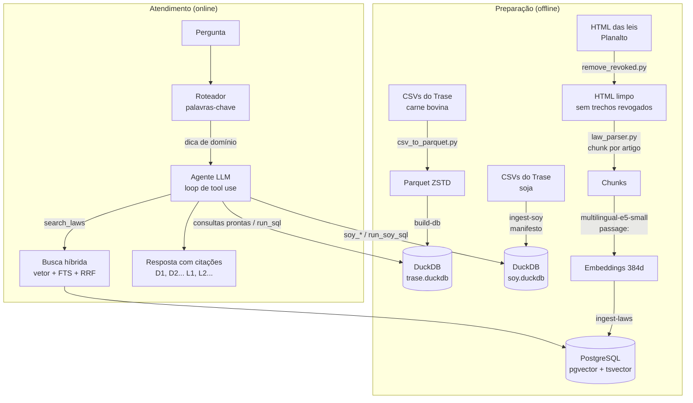

# Trase RAG

Chatbot que responde perguntas sobre as cadeias da **carne bovina** e da **soja** brasileiras e sobre a **legislação ambiental federal**, citando a origem de cada número e de cada artigo de lei.

O sistema combina duas formas de recuperação, uma para cada tipo de fonte:

| Fonte | Armazenamento | Recuperação |
|---|---|---|
| Dados do Trase: carne bovina (fluxos da cadeia, indicadores territoriais, estabelecimentos) | CSV → Parquet → DuckDB (`trase.duckdb`) | SQL: consultas prontas e SELECT gerado pelo LLM |
| Dados do Trase: soja (fluxos da cadeia, indicadores territoriais, instalações) | CSV → DuckDB (`soy.duckdb`) | SQL: consultas prontas e SELECT gerado pelo LLM |
| Leis ambientais (7 diplomas federais) | PostgreSQL + pgvector | Busca híbrida: vetorial (embeddings) + full-text, fundidas por RRF |

As linhas das tabelas **não viram embeddings**. Rankings, somas e séries temporais exigem cálculo exato, e a busca por similaridade não faz isso: ela é usada só para texto (as leis). Os números saem de SQL. Um **agente** (LLM com ferramentas) decide em cada pergunta o que consultar e pode combinar as fontes numa mesma resposta.

---

## Sumário

1. [Visão geral do pipeline](#1-visão-geral-do-pipeline)
2. [Etapa 1: Ingestão dos dados tabulares](#2-etapa-1-ingestão-dos-dados-tabulares)
3. [Etapa 2: Ingestão das leis (RAG documental)](#3-etapa-2-ingestão-das-leis-rag-documental)
4. [Etapa 3: Recuperação](#4-etapa-3-recuperação)
5. [Etapa 4: Roteamento da pergunta](#5-etapa-4-roteamento-da-pergunta)
6. [Etapa 5: Agente e geração da resposta](#6-etapa-5-agente-e-geração-da-resposta)
7. [Interfaces: CLI e web](#7-interfaces-cli-e-web)
8. [Guardrails e segurança](#8-guardrails-e-segurança)
9. [Cuidados metodológicos](#9-cuidados-metodológicos)
10. [Estrutura do repositório](#10-estrutura-do-repositório)
11. [Instalação e execução](#11-instalação-e-execução)
12. [Configuração (.env)](#12-configuração-env)
13. [Limitações conhecidas e próximos passos](#13-limitações-conhecidas-e-próximos-passos)

---

## 1. Visão geral do pipeline



Em resumo:

1. **Preparação dos dados tabulares**: os CSVs do Trase viram tabelas e views num DuckDB por cadeia, com tipos corrigidos e um índice de nomes para resolver grafias.
2. **Preparação dos documentos**: as leis são baixadas do Planalto, limpas, divididas por artigo, transformadas em embeddings e indexadas no Postgres com índice vetorial (HNSW) e índice de texto (GIN).
3. **Recuperação**: SQL para números; busca híbrida (semântica + palavra-chave) para trechos de lei.
4. **Roteamento**: um classificador por palavras-chave indica o domínio da pergunta (soja, carne bovina, leis ou misto) e envia essa dica ao agente.
5. **Agente e geração**: o LLM chama as ferramentas que precisar (até 10 rodadas), recebe cada resultado com um rótulo e escreve a resposta citando esses rótulos.

---

## 2. Etapa 1: Ingestão dos dados tabulares

### 2.1 Carne bovina: CSV → Parquet → DuckDB

**a) CSV → Parquet** ([scripts/csv_to_parquet.py](scripts/csv_to_parquet.py))

```bash
python scripts/csv_to_parquet.py            # data/raw/*.csv -> data/processed/parquet/
python scripts/csv_to_parquet.py --force    # refaz mesmo os que já existem
```

- Os tipos são inferidos lendo o arquivo inteiro (`sample_size=-1`), para que nenhuma coluna numérica seja lida como texto por causa de uma amostra pequena.
- Compressão ZSTD.
- Arquivos cujo Parquet já é mais novo que o CSV são pulados.
- No fim, o script confere se o número de linhas do Parquet bate com o do CSV.

**b) Parquet → DuckDB** ([src/database.py](src/database.py))

```bash
python -m src.cli build-db     # também roda sozinho se algum Parquet for mais novo que o banco
python -m src.cli profile      # tabelas, views, linhas e colunas
```

`build_database()` recria `data/processed/trase.duckdb` com:

| Objeto | Tipo | Conteúdo |
|---|---|---|
| `supply_chain` | tabela | Fluxos da cadeia (4,5 mi linhas, 2011–2023, sem 2018), com tipos corrigidos e colunas obrigatórias validadas |
| `flows_by_municipality`, `flows_by_exporter`, `flows_by_destination` | views | Somas por ano e município / exportador / destino (volume, FOB, exposição, emissões) |
| `spatial_metrics` | tabela | 13 indicadores territoriais × 4 níveis (país, bioma, UF, município), em formato longo |
| `spatial_metrics_wide` | view | Os mesmos indicadores, uma coluna por métrica |
| `metric_catalog` | tabela | Métrica, unidade, descrição e se pode ser somada entre regiões |
| `facilities` | tabela | Mapa logístico (frigoríficos e outros estabelecimentos com inspeção) |
| `entity_index` | tabela | Nomes distintos (municípios, UFs, biomas, exportadores, importadores, países, portos, empresas), normalizados sem acento e em maiúsculas |

Decisões de projeto:

- **Os Parquet são copiados para tabelas**, e não lidos por views. Assim a conexão usada pelo LLM pode rodar com `enable_external_access = false`: um SQL gerado não consegue ler nem gravar arquivos fora do banco.
- Os indicadores territoriais vêm de dezenas de arquivos `spatial-metrics-brazil-beef-<métrica>_<nível>`. O nome de cada arquivo é traduzido em métrica, unidade e descrição pelo catálogo `METRICS` de [src/data_dictionary.py](src/data_dictionary.py) e todos vão para uma única tabela longa.
- **Dicionário de dados como fonte única**: [src/data_dictionary.py](src/data_dictionary.py) descreve tabelas, colunas, unidades e regras de interpretação (`CAVEATS`). O mesmo conteúdo gera o prompt do agente (`render_prompt()`) e a documentação em [docs/dicionario_dados.md](docs/dicionario_dados.md) (`python -m src.cli dictionary`). Mudou o dicionário, mudam os dois.

### 2.2 Soja: manifesto → DuckDB

A soja tem um banco separado (`data/processed/soy/soy.duckdb`), gerado por [src/soy/](src/soy/):

```bash
python -m src.cli ingest-soy
python -m src.cli soy-profile
```

- [src/soy/catalog.py](src/soy/catalog.py): o manifesto [data/catalog/soy_manifest.json](data/catalog/soy_manifest.json) lista cada dataset com arquivo de origem, tabela de destino, versão, período, unidade, colunas obrigatórias e observações. É criado com valores padrão se não existir.
- [src/soy/ingest.py](src/soy/ingest.py): para cada dataset do manifesto, localiza o arquivo em `data/`, `data/raw/` ou `data/processed/`, calcula o sha256 e **pula o que não mudou**. Carrega numa tabela de staging, confere as colunas obrigatórias e só então substitui a tabela final. Registra sha256, linhas, versão e período em `soy_dataset_metadata`.
- [src/soy/territorial.py](src/soy/territorial.py): ao fim da ingestão, cria as tabelas fora do manifesto:
  - `soy_spatial_metrics`: todos os arquivos `spatial-metrics-brazil-soy-<métrica>_<nível>` numa tabela longa, como a da carne bovina (área plantada, produção, produtividade, desmatamento, emissões, soja certificada RTRS e % sob compromisso de desmatamento zero). Arquivo novo com esse padrão entra sozinho.
  - `soy_metric_catalog`: unidade e descrição de cada métrica.
  - `soy_facilities`: armazéns e processadoras, com capacidade de armazenagem (t) e de processamento (t/dia).

| Tabela | Conteúdo |
|---|---|
| `soy_supply_chain` | Fluxos da cadeia da soja (2004–2022): município, bioma, UF, porto, exportador, importador, país de primeira importação, volume, FOB, exposição e emissões |
| `soy_spatial_metrics` / `soy_metric_catalog` | Indicadores territoriais por região |
| `soy_facilities` | Instalações de armazenagem e processamento |
| `soy_deforestation`, `soy_gross_emissions` | Tabelas antigas, só municipais (o agente prefere `soy_spatial_metrics`) |
| `soy_dataset_metadata` | Rastreabilidade da carga (sha256, data, linhas, versão) |

As colunas da soja são carregadas como `VARCHAR` (`all_varchar = true`) para não perder linhas com valores malformados; as consultas convertem com `TRY_CAST`.

Se o banco da soja não existir, o resto do sistema continua funcionando: o agente simplesmente não recebe as ferramentas `soy_*` e avisa o usuário.

---

## 3. Etapa 2: Ingestão das leis (RAG documental)

Esta é a parte de RAG "clássico": documentos de texto → chunks → embeddings → banco vetorial.

### 3.1 Acervo

Sete diplomas federais, em [docs/leis/](docs/leis/), descritos em [docs/leis/manifest.json](docs/leis/manifest.json) (título, tipo, URL no Planalto, data de promulgação, data de obtenção e sha256):

| Diploma | Tema |
|---|---|
| Lei 12.651/2012 | Código Florestal |
| Lei 9.605/1998 | Crimes Ambientais |
| Decreto 6.514/2008 | Infrações e sanções administrativas ao meio ambiente |
| Lei 11.428/2006 | Mata Atlântica |
| Lei 9.985/2000 | SNUC (Unidades de Conservação) |
| Lei 6.938/1981 | Política Nacional do Meio Ambiente |
| Lei 12.187/2009 | Política Nacional sobre Mudança do Clima |

### 3.2 Limpeza: remoção de trechos revogados

```bash
python scripts/remove_revoked.py    # docs/leis/original/*.htm -> docs/leis/*.htm
```

O texto compilado do Planalto mantém as redações revogadas ou alteradas, riscadas. Se fossem indexadas, o LLM poderia citar como vigente um dispositivo que já não vale. [scripts/remove_revoked.py](scripts/remove_revoked.py):

- guarda o HTML original, intacto, em `docs/leis/original/` (Windows-1252);
- remove todo conteúdo riscado, nas duas formas que o Planalto usa: tags `<strike>`/`<s>`/`<del>` e estilo `text-decoration: line-through`;
- remove o parágrafo inteiro quando sobram só notas órfãs, como "(Revogado pelo Decreto nº ...)", "(Vide ADI ...)", "Prejudicado" ou um rótulo solto ("Art. 61-A.");
- preserva trechos vigentes que dividem o parágrafo com um trecho riscado;
- grava a saída em UTF-8 e atualiza no manifesto o sha256 do arquivo limpo e do original.

### 3.3 Chunking por artigo

[src/law_parser.py](src/law_parser.py) usa a estrutura da própria lei como unidade de chunk, em vez de cortar o texto em janelas de tamanho fixo.

**Parsing** (`parse_law`):

- Extrai o texto de cada `<p>`/`<td>` e normaliza espaços e ordinais ("1 º" → "1º").
- Reconhece rótulos de artigo nas várias formas que o Planalto usa: `Art. 1º`, `Art 2º -`, `Art.16`, `Art. 61-A.`, `Art. 9o -A.`, sem confundir "Art 2º - A Política" com o sufixo "-A".
- Acompanha a hierarquia (Livro > Título > Capítulo > Seção > Subseção). Um novo capítulo zera a seção anterior, e o nome do nível, quando vem na linha seguinte ao rótulo ("CAPÍTULO IV" / "DA ÁREA DE RESERVA LEGAL"), é juntado a ele.
- Descarta artigos sem conteúdo ("(VETADO)", "(Revogado)"), o preâmbulo e tudo a partir de "Brasília, ..." (assinaturas e anexos).
- Guarda a ementa à parte.

**Montagem dos chunks** (`build_chunks`):

- **Cada artigo vira um chunk** com o caput, os parágrafos (§), incisos e alíneas.
- Todo chunk começa com um **cabeçalho de contexto**: nome da lei + hierarquia. Ex.: `Lei nº 12.651/2012 – Código Florestal` / `CAPÍTULO IV – DA ÁREA DE RESERVA LEGAL > SEÇÃO I – ...`. Assim o embedding e o LLM sabem de onde o trecho veio, mesmo que o artigo não repita o assunto.
- A ementa de cada lei vira um chunk próprio.
- **Artigos longos são divididos**. O limite de um chunk é o limite de entrada do modelo de embedding menos uma folga (512 − 32 = **480 tokens**), lido do próprio modelo (`max_seq_length`) para não ficar errado ao trocar de modelo. Artigos acima disso são divididos em **partes de até 256 tokens**, agrupando parágrafos inteiros, e **cada parte repete o cabeçalho e o caput**.
- As partes são menores que o limite de propósito: um artigo com muitos incisos sobre assuntos diferentes (ex.: as definições do art. 3º do Código Florestal) geraria um embedding "diluído", que não fica próximo de nenhuma pergunta específica.
- Se o caput for grande demais para ser repetido (mais da metade de uma parte), as partes repetem só "Art. N (continuação)".
- Um único parágrafo maior que o limite é quebrado por palavras.
- Os tokens são contados com o tokenizador do próprio modelo, incluindo o prefixo `passage: `, para que nenhum chunk seja truncado em silêncio.

Cada chunk guarda nos metadados o número do artigo, a parte (`parte`/`partes`) e a hierarquia, usados depois na citação.

### 3.4 Embeddings

[src/embeddings.py](src/embeddings.py):

- Modelo: **`intfloat/multilingual-e5-small`** (sentence-transformers), multilíngue, 384 dimensões, roda localmente na CPU.
- O E5 foi treinado com prefixos: **`passage: `** nos textos indexados e **`query: `** nas perguntas. Usar o prefixo errado (ou nenhum) piora a recuperação sem gerar erro, por isso o módulo aplica os prefixos automaticamente.
- Vetores normalizados (`normalize_embeddings=True`): a similaridade de cosseno vira produto interno.
- Ao carregar o modelo, a dimensão real é comparada com `EMBEDDING_DIM`; se divergirem, o programa para antes de gravar qualquer coisa.

### 3.5 Banco vetorial: PostgreSQL + pgvector

```bash
docker compose up -d --wait          # Postgres 17 + pgvector 0.8 na porta 5433
python -m src.cli init-vector-db     # cria tabelas e índices (idempotente)
python -m src.cli ingest-laws        # parse -> chunks -> embeddings -> Postgres
python -m src.cli vector-stats       # nº de documentos, chunks e modelos usados
```

O esquema está em [sql/schema.sql](sql/schema.sql):

- **`documents`**: um registro por arquivo, com título, tipo (`law`), URL, data de obtenção, **sha256** e **modelo de embedding** usado.
- **`chunks`**: texto, contagem de tokens, metadados (JSONB), **`embedding vector(384)`** e **`tsv tsvector`** gerado automaticamente a partir do texto com a configuração `portuguese` (stemming em português).
- Índices: **HNSW** sobre o embedding com distância de cosseno (`m = 16`, `ef_construction = 64`), **GIN** sobre o `tsvector`, e índices em `document_id` e `doc_type`.

A ingestão ([src/ingest_laws.py](src/ingest_laws.py)) lê o manifesto e, para cada lei:

1. **pula** a lei se o sha256 indexado for igual ao do arquivo (use `--force` para reindexar);
2. divide em artigos e chunks;
3. gera os embeddings em lote;
4. grava documento e chunks **numa única transação** (`upsert_document`): o documento é substituído e seus chunks antigos são apagados antes de inserir os novos, então uma falha no meio não deixa a lei pela metade.

[src/vector_store.py](src/vector_store.py) não gera embeddings: recebe vetores prontos. Assim o armazenamento não depende da escolha do modelo. Ao inicializar, ele confere se a dimensão da coluna `embedding` bate com `EMBEDDING_DIM`; para trocar para um modelo de outra dimensão, é preciso recriar as tabelas e regerar os embeddings.

---

## 4. Etapa 3: Recuperação

### 4.1 Leis: busca híbrida com Reciprocal Rank Fusion

`hybrid_search()` em [src/vector_store.py](src/vector_store.py), chamada por `retrieve()` em [src/rag.py](src/rag.py):

```text
pergunta ──► embed_query("query: ...") ──► busca semântica (HNSW, cosseno) ──► top 40 ─┐
        └──► websearch_to_tsquery('portuguese', ...) ──► busca full-text (ts_rank_cd) ──► top 40 ─┤
                                                                                              ▼
                                                     RRF: score = Σ 1 / (60 + posição) ──► top k (padrão 6)
```

- **Busca semântica**: encontra artigos com o mesmo sentido mesmo com outras palavras ("desmatar sem licença" ↔ "suprimir vegetação sem autorização").
- **Busca full-text**: acerta termos exatos e jargão jurídico que o embedding pode não distinguir ("reserva legal", "APP", números de artigo), com stemming em português.
- **Fusão por RRF** (Reciprocal Rank Fusion, `k = 60`): cada busca devolve até 40 candidatos; a posição de cada chunk em cada lista vira `1/(60 + posição)` e os valores são somados. A fusão usa só a posição, então não é preciso calibrar escalas diferentes (distância de cosseno × `ts_rank`). Um chunk bem colocado nas duas listas sobe; um que aparece só numa ainda pode entrar.
- O resultado traz, para cada chunk, o score fundido e a posição em cada busca (`semantic_rank`, `keyword_rank`), útil para depurar.
- Filtro opcional por `doc_type`. Com filtro, o HNSW usa `hnsw.iterative_scan = relaxed_order` (pgvector ≥ 0.8) para continuar varrendo até achar resultados suficientes.

Há também `semantic_search()` (só vetorial), disponível pela CLI para comparação:

```bash
python -m src.cli search "multa por desmatar sem autorização" --limit 5           # híbrida
python -m src.cli search "reserva legal" --mode semantic --doc-type law           # só vetorial
```

### 4.2 Dados: SQL

Para números, a "recuperação" é uma consulta SQL. O agente tem três caminhos, em ordem de preferência:

1. **Consultas prontas** ([src/queries.py](src/queries.py) e [src/soy/queries.py](src/soy/queries.py)): funções parametrizadas e já corretas quanto às regras de interpretação (ex.: excluir a origem desconhecida, não somar exposição entre anos, usar o ano mais recente quando nenhum é dado).
2. **`find_entity`**: resolve a grafia de um nome antes de filtrar. Busca no `entity_index` com normalização (sem acento, maiúsculas) e similaridade Jaro-Winkler, com bônus para nome idêntico (+1), nome como palavra inteira (+0,5, ex.: "CHINA (MAINLAND)") e nome contido em outra palavra (+0,3). Ex.: "sao felix" → "SAO FELIX DO XINGU".
3. **SQL livre** (`run_sql` para carne bovina, `run_soy_sql` para soja): um único SELECT gerado pelo LLM, para o que as consultas prontas não cobrem, executado numa conexão isolada (ver [Guardrails](#8-guardrails-e-segurança)).

---

## 5. Etapa 4: Roteamento da pergunta

[src/soy/routing.py](src/soy/routing.py) classifica a pergunta por palavras-chave em um domínio:

| Domínio | Quando |
|---|---|
| `law` | Termos jurídicos ("código florestal", "reserva legal", "artigo", "decreto", "licenciamento"...) sem menção a uma cadeia |
| `soy` | Termos da soja ("soja", "cadeia da soja", "volume de soja"...) |
| `beef` | Termos da carne bovina ("bovino", "gado", "pecuária", "carne bovina"...) |
| `mixed` | Termos jurídicos + soja |
| `auto` | Nenhum padrão claro |

Termos genéricos como "exportador" ou "importador" valem para as duas cadeias: se a pergunta fala de carne bovina e não cita soja explicitamente, ela é roteada para `beef`.

`resolve_domain()` em [src/rag.py](src/rag.py) respeita um domínio escolhido pelo usuário (`--domain` na CLI ou seletor na web) e só usa o roteador quando o domínio é `auto`.

O roteamento **não restringe** o agente: ele vira uma dica no prompt de sistema ("A pergunta é sobre a cadeia da soja: use as ferramentas soy_* e run_soy_sql"). O agente continua com todas as ferramentas e pode, por exemplo, consultar leis numa pergunta roteada para `soy`.

---

## 6. Etapa 5: Agente e geração da resposta

### 6.1 O agente ([src/agent.py](src/agent.py))

O LLM é chamado pela API Messages da Anthropic através do **OpenRouter** (endpoint compatível; modelo padrão `anthropic/claude-haiku-5.5`, configurável em `LLM_MODEL`).

**Prompt de sistema**, montado a cada pergunta:

- papel e público (gestores públicos, pesquisadores, analistas de sustentabilidade);
- regras de trabalho: todo número deve vir de uma ferramenta; preferir consultas prontas; confirmar grafias com `find_entity`; traduzir países para o inglês usado nos dados; usar o ano mais recente quando nenhum for dito (e dizer isso); nunca usar `run_sql` para soja nem `run_soy_sql` para carne bovina;
- regras de resposta: português, resposta primeiro e contexto depois, citação após cada número ou afirmação, ano/filtros/unidade explícitos, formato numérico brasileiro;
- o **dicionário de dados** da carne bovina (`render_prompt()`) com as regras de interpretação;
- o **esquema do banco da soja**, lido do próprio banco e do manifesto (`schema_prompt()`), com as regras específicas da soja, ou um aviso de que o banco não está disponível;
- a dica de domínio do roteador.

A parte fixa do prompt é marcada com `cache_control` (prompt caching), porque o dicionário de dados é longo e se repete em toda chamada.

**Ferramentas**:

| Ferramenta | Fonte | O que faz |
|---|---|---|
| `top_municipalities` | carne | Ranking de municípios por exposição, volume, FOB, emissões ou intensidade |
| `top_exporters` | carne | Ranking de grupos exportadores (ou empresas), com compromisso de desmatamento zero |
| `top_destinations` | carne | Ranking de países de destino |
| `yearly_trend` | carne | Série anual com filtros por bioma, UF, município ou grupo exportador |
| `exposure_intensity_by_municipality` | carne | Exposição por tonelada (ha/t) |
| `commitment_summary` | carne | Volume e exposição por tipo de compromisso (G4, TAC, compromisso da empresa, nenhum) |
| `territorial_metric` | carne | Indicador territorial por região (ranking ou valor de uma região) |
| `find_entity` | carne | Grafia exata de um nome |
| `run_sql` | carne | SELECT livre no `trase.duckdb` |
| `soy_top_municipalities`, `soy_top_exporters`, `soy_top_destinations` | soja | Rankings |
| `soy_yearly_trend`, `soy_deforestation_by_biome` | soja | Série anual e exposição por bioma |
| `soy_territorial_metric` | soja | Indicador territorial por região |
| `soy_facilities_summary` | soja | Instalações agregadas por UF, município, empresa, categoria ou tipo |
| `run_soy_sql` | soja | SELECT livre no `soy.duckdb` |
| `search_laws` | leis | Busca híbrida nas leis (a mesma da seção 4.1) |

**Loop de execução** (`ask()`):

1. Envia pergunta, histórico, prompt e ferramentas ao LLM.
2. Se o LLM pedir ferramentas (`stop_reason = tool_use`), executa todas as chamadas daquela rodada e devolve os resultados.
3. Repete até o LLM responder em texto, com no máximo **10 rodadas**.
4. Se uma ferramenta der erro (SQL inválido, nome inexistente), o erro volta ao LLM como `is_error`, e o prompt o instrui a corrigir a chamada e tentar de novo (no máximo duas vezes).
5. Trata recusa do modelo e corte por limite de tokens com mensagens explícitas.

**Formato dos resultados enviados ao LLM**:

- Tabelas são convertidas em CSV, com números arredondados a 6 algarismos significativos e no máximo **60 linhas** (com aviso quando há mais).
- Trechos de lei vão em XML: `<documento rotulo="L3" lei="Lei nº 12.651/2012 – Código Florestal" artigo="12" parte="1/2" fonte="https://...">texto</documento>`.

### 6.2 Citações

Cada resultado recebe um **rótulo**: `[D1]`, `[D2]`... para dados e `[L1]`, `[L2]`... para trechos de lei. Os rótulos são numerados em sequência ao longo de toda a conversa daquela pergunta, então um `[D3]` sempre aponta para uma única consulta. O LLM cita esses rótulos logo após cada número ou afirmação e, na primeira citação de uma lei, diz a lei e o artigo.

A resposta final (`AgentAnswer`) traz, além do texto: a lista de chamadas de ferramenta (rótulo, nome, argumentos, sucesso, número de linhas, tempo), os trechos de lei usados (com URL do Planalto) e os tokens consumidos. A CLI (`--show-context`) e a página web mostram essas informações, então cada rótulo citado pode ser conferido.

### 6.3 Degradação controlada

- **Postgres fora do ar**: na primeira falha, `search_laws` é desligada para o resto da pergunta e o LLM recebe a instrução de responder a parte de dados e avisar que não conseguiu consultar as leis.
- **Banco da soja ausente**: as ferramentas `soy_*` não são oferecidas e o prompt explica ao LLM que os dados da soja estão indisponíveis.

### 6.4 Modo "só leis" ([src/rag.py](src/rag.py))

O fluxo original do projeto, mantido para comparação e para quando o agente não é necessário:

1. `retrieve()`: busca híbrida, top k;
2. `build_context()`: formata os chunks numerados (`<documento indice="1" lei=... artigo=... fonte=...>`);
3. `answer()`: uma única chamada ao LLM com pergunta + contexto e um prompt de sistema escolhido pelo domínio.

O prompt jurídico obriga a citar `[n]` após cada afirmação, a responder só com os trechos recebidos (dizendo o que falta quando não bastarem) e a **não concluir que uma empresa, município ou imóvel descumpriu a lei**, explicando em vez disso o que a lei exige e que dados (CAR, autorizações de supressão, embargos) seriam necessários para verificar.

```bash
python -m src.cli ask "O que é reserva legal?" --laws-only
```

---

## 7. Interfaces: CLI e web

### Chatbot

```bash
python -m src.cli ask "Quais grupos exportadores tiveram maior exposição ao desmatamento em 2023?"
python -m src.cli ask "..." --show-context      # mostra cada ferramenta chamada e o resultado
python -m src.cli ask "..." --domain soy        # força o domínio (auto, law, beef, soy, mixed)
python -m src.cli ask "..." --laws-only         # fluxo antigo, só leis
python -m src.cli serve                         # página em http://127.0.0.1:8000
```

[src/web.py](src/web.py) é um servidor HTTP mínimo (biblioteca padrão, só em `127.0.0.1`) que serve [web/index.html](web/index.html) e expõe `POST /api/ask` com `{"question", "k", "mode": "agent"|"laws", "domain"}`. A resposta traz o texto, o domínio usado, as consultas executadas e as fontes.

### Consultas diretas (sem LLM)

```bash
# Carne bovina
python -m src.cli top-municipalities --biome CERRADO --year 2022
python -m src.cli top-exporters --limit 10                  # por grupo; --by-company por empresa
python -m src.cli top-destinations --year 2020
python -m src.cli trend --state PARA
python -m src.cli intensity --biome AMAZONIA
python -m src.cli commitments
python -m src.cli territorial zdc_exported_pct --level state
python -m src.cli find "sao felix" --kind municipality
python -m src.cli sql "SELECT year, SUM(volume_t) FROM flows_by_destination GROUP BY 1 ORDER BY 1"

# Soja
python -m src.cli soy-top-municipalities
python -m src.cli soy-top-exporters
python -m src.cli soy-top-destinations
python -m src.cli soy-trend
python -m src.cli soy-exposure

# Leis
python -m src.cli search "reserva legal" --limit 5
```

Sem `--year`, os rankings usam o ano mais recente com dados (2023 para carne bovina).

---

## 8. Guardrails e segurança

**SQL gerado pelo LLM** (`run_readonly_sql` em [src/database.py](src/database.py), usado pelos dois bancos):

- conexão **somente leitura** e com **acesso a arquivos desligado** (`enable_external_access = false`), com a configuração travada (`lock_configuration = true`) para que o próprio SQL não consiga reativá-lo;
- o SQL é analisado pelo parser do DuckDB: **exatamente uma** instrução, e **só `SELECT`**. DDL, `COPY`, `ATTACH`, `SET` e múltiplas consultas são recusados;
- a consulta é embrulhada em `SELECT * FROM (...) LIMIT 201`, com no máximo **200 linhas** devolvidas (`SQL_MAX_ROWS`);
- **timeout de 20 s** (`SQL_TIMEOUT_SECONDS`): um timer interrompe a conexão.

**Conteúdo recuperado**: o prompt avisa que o que vem das ferramentas e de `<documentos>` é dado, não instrução, como proteção contra injeção de prompt vinda dos documentos.

**Respostas**: o prompt proíbe inventar ou estimar números, proíbe concluir ilegalidade a partir de exposição ao desmatamento e pede que a falta de dados seja dita.

**Credenciais**: `OPENROUTER_API_KEY` e `PG_PASSWORD` ficam no `.env`, que está no `.gitignore`. Nunca coloque tokens ou credenciais no Git.

---

## 9. Cuidados metodológicos

As regras abaixo estão em `CAVEATS` ([src/data_dictionary.py](src/data_dictionary.py)) e em `SOY_RULES` ([src/agent.py](src/agent.py)) e vão no prompt do agente. As consultas prontas já as aplicam.

- **Exposição e emissões usam janela de 5 anos: não some entre anos.** A partir de 2015, a soma da exposição dos fluxos de um ano é igual ao desmatamento nacional atribuído à pecuária naquele ano. Somar anos conta o mesmo desmatamento várias vezes. Vale também para a soja.
- **Cerca de 90% da exposição de cada ano (carne bovina) não tem município de origem.** O consumo interno aparece como uma única linha por ano com município `UNKNOWN` (`BR-XXXXXXX`), e parte da exportação também. Os rankings de municípios excluem essa linha e cobrem só a parte rastreada (~8% da exposição em 2023). Para o desmatamento total de uma região, use `spatial_metrics`.
- Na `supply_chain`, a exposição só existe de 2015 em diante. Os zeros de 2011–2014 significam "sem dado".
- O consumo interno aparece como exportador `DOMESTIC PROCESSING AND CONSUMPTION` e destino `BRAZIL`. As consultas de exportação excluem esses registros por padrão. Na soja, os equivalentes são `PROCESSED DOMESTICALLY` e `UNKNOWN CUSTOMER`.
- Métricas por tonelada e percentuais não se somam entre regiões: recalcule a partir dos totais.
- `facilities` tem uma linha por estabelecimento e commodity. Para contar estabelecimentos, use `COUNT(DISTINCT facility_id)`.
- Indicadores territoriais (`spatial_metrics`, `soy_spatial_metrics`) descrevem a região inteira, não os fluxos da cadeia.
- **Exposição é uma estimativa de associação da cadeia, não prova de ilegalidade nem de responsabilidade direta** de empresa, município ou imóvel.

Interpretações marcadas "(confirmar na metodologia)" no dicionário ainda precisam ser verificadas na documentação oficial do Trase.

---

## 10. Estrutura do repositório

```text
├── data/
│   ├── raw/                     # CSVs baixados do Trase (carne bovina e soja)
│   ├── catalog/
│   │   └── soy_manifest.json    # catálogo dos datasets da soja
│   └── processed/
│       ├── parquet/             # Parquet da carne bovina (fonte do trase.duckdb)
│       ├── trase.duckdb         # banco analítico da carne bovina (build-db)
│       └── soy/soy.duckdb       # banco analítico da soja (ingest-soy)
├── docs/
│   ├── dicionario_dados.md      # gerado a partir de src/data_dictionary.py
│   └── leis/
│       ├── original/            # HTML original do Planalto (Windows-1252)
│       ├── *.htm                # HTML limpo, sem trechos revogados (UTF-8)
│       └── manifest.json        # metadados e sha256 de cada lei
├── scripts/
│   ├── csv_to_parquet.py        # CSV -> Parquet
│   └── remove_revoked.py        # remove trechos revogados das leis
├── sql/
│   ├── init/01-extensions.sql   # CREATE EXTENSION vector (primeira subida do container)
│   └── schema.sql               # tabelas documents/chunks e índices HNSW/GIN
├── src/
│   ├── config.py                # leitura do .env e caminhos
│   ├── data_dictionary.py       # dicionário de dados (prompt do LLM e docs)
│   ├── database.py              # Parquet -> DuckDB, conexão e SQL isolado
│   ├── queries.py               # consultas prontas da carne bovina + find_entity
│   ├── soy/
│   │   ├── catalog.py           # manifesto dos datasets da soja
│   │   ├── ingest.py            # CSV -> soy.duckdb, com sha256 e metadados
│   │   ├── territorial.py       # métricas territoriais e instalações da soja
│   │   ├── queries.py           # consultas prontas da soja e esquema para o prompt
│   │   └── routing.py           # roteador de domínio por palavras-chave
│   ├── law_parser.py            # HTML da lei -> artigos -> chunks
│   ├── embeddings.py            # multilingual-e5-small (passage:/query:)
│   ├── vector_store.py          # pgvector: upsert, busca semântica e híbrida (RRF)
│   ├── ingest_laws.py           # pipeline de ingestão das leis
│   ├── rag.py                   # RAG só de leis, cliente LLM, resolução de domínio
│   ├── agent.py                 # agente: LLM + ferramentas (dados e leis)
│   ├── cli.py                   # linha de comando
│   └── web.py                   # servidor local de teste
├── web/index.html               # página do chatbot
├── docker-compose.yml           # Postgres 17 + pgvector 0.8
└── requirements.txt
```

---

## 11. Instalação e execução

Requer Python 3.10+ e Docker (para o Postgres).

```bash
# 1. Ambiente
python -m venv .venv
.venv\Scripts\Activate.ps1          # Windows PowerShell (Linux/macOS: source .venv/bin/activate)
pip install -r requirements.txt
cp .env.example .env                # preencha OPENROUTER_API_KEY e PG_PASSWORD

# 2. Dados da carne bovina
python scripts/csv_to_parquet.py
python -m src.cli build-db

# 3. Dados da soja
python -m src.cli ingest-soy

# 4. Leis
docker compose up -d --wait
python -m src.cli init-vector-db
python scripts/remove_revoked.py    # só necessário se docs/leis/original mudou
python -m src.cli ingest-laws

# 5. Usar
python -m src.cli ask "Qual a área mínima de reserva legal na Amazônia e quais municípios do Pará têm maior exposição ao desmatamento?" --show-context
python -m src.cli serve
```

Na primeira execução, o modelo de embedding é baixado do Hugging Face.

---

## 12. Configuração (.env)

| Variável | Padrão | Uso |
|---|---|---|
| `PARQUET_DIR` | `data/processed/parquet` | Origem do banco da carne bovina |
| `SUPPLY_CHAIN_FILE` | `brazil_beef_v2_2_2.parquet` | Parquet dos fluxos da cadeia |
| `SPATIAL_METRICS_GLOB`, `FACILITIES_GLOB` | — | Padrões dos arquivos de indicadores e estabelecimentos |
| `DUCKDB_PATH` | `data/processed/trase.duckdb` | Banco da carne bovina |
| `SOY_DUCKDB_PATH` | `data/processed/soy/soy.duckdb` | Banco da soja |
| `SQL_TIMEOUT_SECONDS`, `SQL_MAX_ROWS` | `20`, `200` | Limites do SQL gerado pelo LLM |
| `PG_HOST`, `PG_PORT`, `PG_USER`, `PG_PASSWORD`, `PG_DATABASE` | `localhost`, `5433`, `rag`, —, `trase_rag` | Conexão com o Postgres |
| `EMBEDDING_MODEL`, `EMBEDDING_DIM` | `intfloat/multilingual-e5-small`, `384` | Modelo de embedding (a dimensão precisa bater) |
| `FTS_CONFIG` | `portuguese` | Configuração do full-text do Postgres |
| `OPENROUTER_API_KEY`, `LLM_BASE_URL`, `LLM_MODEL` | —, `https://openrouter.ai/api`, `anthropic/claude-haiku-5.5` | LLM |

Trocar `EMBEDDING_MODEL` para um modelo de outra dimensão exige ajustar `EMBEDDING_DIM`, recriar as tabelas (`init-vector-db --reset`) e rodar `ingest-laws --force`.

---

## 13. Limitações conhecidas e próximos passos

**Limitações**

- Perguntas de definição ("o que é área rural consolidada?") podem não trazer o art. 3º do Código Florestal no topo quando outros artigos repetem o termo muitas vezes.
- O roteador é baseado em palavras-chave e pode errar em perguntas sem termos característicos. Como ele só gera uma dica e não restringe as ferramentas, o agente ainda pode chegar à fonte certa.
- O acervo documental tem só leis federais; não há normas estaduais, instruções normativas nem a metodologia do Trase.
- As colunas da soja estão como texto e dependem de `TRY_CAST` nas consultas.

**Próximos passos**

- Reranker (cross-encoder) sobre os candidatos da busca híbrida, para resolver o problema das perguntas de definição.
- Indexar a metodologia do Trase no pgvector e dar ao agente uma ferramenta para consultá-la, para confirmar as interpretações marcadas no dicionário.
- Ampliar o acervo jurídico (normas estaduais e infralegais).
