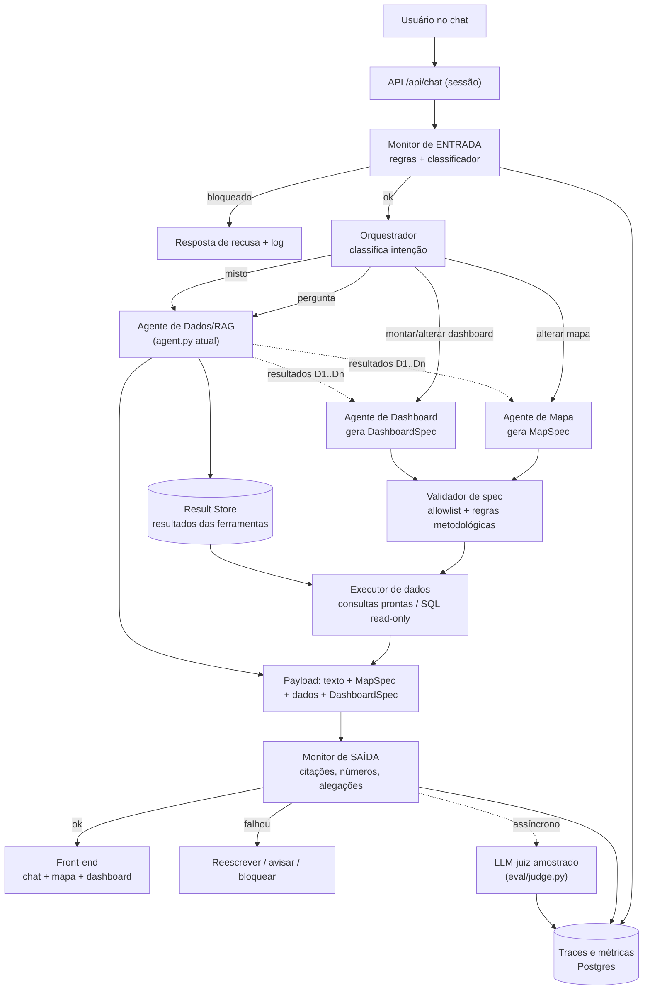

# Avaliação e pipeline: chatbot com mapa, dashboards e agente monitor

## 1. Ponto de partida (o que já existe)

| Peça | Situação atual | Impacto nas novas funções |
|---|---|---|
| [agent.py](../src/agent.py) | Um agente com tool use (até 10 rodadas), planejamento para perguntas mistas, rótulos `[D1]`/`[L1]` | Vira **um dos especialistas** (o "Agente de Dados/RAG"), não precisa ser reescrito |
| `ToolCall` / `AgentAnswer` | Guardam rótulo, ferramenta, argumentos, nº de linhas — **mas não as linhas** | Para dashboards, os resultados precisam ser **persistidos** (hoje se perdem após a resposta) |
| [web.py](../src/web.py) + [index.html](../web/index.html) | Servidor stdlib, 1 endpoint `POST /api/ask`, página de 175 linhas, **sem mapa nem gráficos** | Precisa de front-end novo (mapa + dashboard) e de estado de sessão no servidor |
| Guardrails | SQL somente leitura, timeout, prompt anti-injeção | Ótima base; o monitor complementa na entrada/saída |
| [eval/judge.py](../eval/judge.py) | LLM-juiz offline | Pode ser reaproveitado pelo monitor (modo online/amostrado) |

## 2. Avaliação da ideia

**A ideia é boa e se encaixa bem na arquitetura**, porque o projeto já separa "números vêm de SQL" de "texto vem do LLM". A recomendação principal é manter essa regra nas novas funções:

> [!IMPORTANT]
> Os agentes de Mapa e de Dashboard **não devem gerar código nem números**. Eles devem produzir uma **especificação JSON validada** (camada, métrica, filtros, tipo de gráfico) e o back-end executa as consultas prontas/SQL e entrega os dados ao front-end. Isso mantém rastreabilidade, segurança e testabilidade.

Pontos de atenção:

1. **Nem tudo precisa ser um agente com loop.** Mapa e dashboard funcionam melhor como "tradutores de intenção → spec" (1 chamada LLM com saída estruturada) do que como agentes livres. Menos latência, menos custo, menos erro.
2. **Mapa-múndi × dados disponíveis.**
   - *Cadeia de suprimentos*: faz sentido no mundo — origem (município/UF/bioma no Brasil) → destino (país). Visualização: choropleth por país e/ou arcos de fluxo.
   - *Desmatamento*: os indicadores são **só do Brasil** (país, bioma, UF, município). No mapa-múndi isso vira um zoom no Brasil, ou "exposição ao desmatamento importada" por país de destino (essa sim é global).
3. **Geometrias e chaves**: será preciso adicionar GeoJSON (países – Natural Earth; municípios/UFs – IBGE; biomas – IBGE) e tabelas de correspondência: nome do país do Trase (inglês, maiúsculo) → ISO3; `trase_id` `BR-XXXXXXX` → código IBGE.
4. **Monitor**: dividir em camada **determinística** (rápida, sempre ativa, pode bloquear) e camada **LLM-juiz** (mais cara, ideal assíncrona ou amostrada). Colocar um LLM bloqueante na entrada *e* na saída pode dobrar a latência.
5. **Atenção à regra metodológica** já existente: o mapa/dashboard não pode somar exposição entre anos nem somar percentuais entre regiões — a validação da spec deve impedir isso (ex.: série temporal ok, "total 2015–2023" bloqueado).

## 3. Pipeline proposto



### 3.1 Etapas

| # | Etapa | O que faz | Tipo |
|---|---|---|---|
| 1 | **API de chat com sessão** | Recebe mensagem + `session_id`; carrega histórico, estado atual do mapa e do dashboard | Código |
| 2 | **Monitor de entrada** | Tamanho, idioma, injeção de prompt/jailbreak, fora de escopo, PII; registra trace | Regras + (opcional) LLM pequeno |
| 3 | **Orquestrador** | Classifica: `question`, `map_edit`, `dashboard_edit`, `mixed`; extrai sub-tarefas | 1 chamada LLM com saída estruturada (estende o roteador atual) |
| 4a | **Agente de Dados/RAG** | O atual, sem mudanças de lógica; passa a gravar as linhas de cada `ToolCall` no Result Store | Agente com loop |
| 4b | **Agente de Mapa** | Lê o pedido + estado atual do mapa → devolve um **patch** do `MapSpec` | 1 chamada LLM, JSON schema |
| 4c | **Agente de Dashboard** | Lê pedido + resultados salvos + spec atual → devolve `DashboardSpec` (painéis, tipo de gráfico, layout) | 1 chamada LLM, JSON schema |
| 5 | **Validador** | Confere métricas/camadas/filtros existentes, entidades via `find_entity`, regras (não somar anos, não somar %) | Código (Pydantic) |
| 6 | **Executor de dados** | Converte spec em consultas prontas/SQL read-only; junta com GeoJSON | Código |
| 7 | **Monitor de saída** | Todo número tem rótulo? Os números citados existem nos resultados? Há alegação de ilegalidade? Spec válida? | Regras (bloqueante) + LLM-juiz (assíncrono) |
| 8 | **Front-end** | Renderiza chat, mapa (MapLibre/deck.gl) e dashboard (ECharts ou Vega-Lite) a partir das specs | Código |
| 9 | **Observabilidade** | Traces por etapa: latência, tokens, ferramenta, veredito do monitor, feedback do usuário | Postgres + painel interno |

### 3.2 Exemplo de `MapSpec`

```json
{
  "mode": "supply_chain",
  "commodity": "soy",
  "year": 2022,
  "layers": [
    {"type": "choropleth", "level": "country", "metric": "volume_t"},
    {"type": "flows", "origin_level": "state", "filter": {"state": "MATO GROSSO"}, "top_n": 10}
  ],
  "highlight": ["CHINA"],
  "viewport": "world",
  "source_labels": ["D3"]
}
```

## 4. Entregas sugeridas (ordem)

1. Result Store + sessão + traces (base para tudo, inclusive o monitor)
2. Monitor determinístico de entrada e saída
3. Orquestrador + Agente de Mapa + front-end do mapa
4. Agente de Dashboard + front-end de dashboards
5. LLM-juiz online amostrado + painel de monitoramento
6. Ampliar `eval/` com casos de mapa, dashboard e ataques (red teaming)

## 5. Monitor: guardrail ou agente?

Hoje o monitor proposto é um **guardrail** (regras fixas que aprovam ou reprovam). Para ser considerado um **agente**, ele precisa de:

1. **Raciocínio com LLM**: um modelo avalia a entrada/saída, não só regex e regras.
2. **Ferramentas próprias** para investigar antes de decidir:
   - `check_numbers`: confere se os números da resposta existem nos resultados `[D1]...[Dn]`;
   - `rerun_query`: reexecuta uma consulta SQL para validar um valor;
   - `search_laws`: confirma se o artigo citado diz o que a resposta afirma;
   - `find_entity`: verifica se município/empresa existe;
   - `get_session_history`: vê tentativas anteriores de ataque.
3. **Autonomia de ação**: escolhe entre aprovar, bloquear, reescrever trechos, devolver ao Agente de Dados com o que corrigir, adicionar aviso ou escalar para um humano/alerta.
4. **Loop com objetivo e memória**: investigar → decidir → agir → reverificar até a resposta estar segura e fundamentada (com limite de rodadas, como o `agent.py`), guardando estado da sessão (ex.: nível de risco do usuário).

Resumo: **guardrail = regra que filtra; agente = LLM + ferramentas + decisão + loop.**

> [!TIP]
> Abordagem híbrida recomendada: regras determinísticas sempre ativas (baratas, bloqueiam na hora) e o agente monitor acionado apenas quando as regras sinalizam algo suspeito, ou de forma assíncrona/amostrada.

## 6. Viabilidade do deck.gl

- A renderização acontece **na GPU do cliente** (navegador); o servidor não precisa de GPU.
- O deck.gl usa **WebGL2** por padrão; o suporte a WebGPU (v9) é experimental e **não é necessário**. Qualquer notebook com GPU integrada recente (Intel Iris, Apple M1+) atende.

Volume medido no parquet da soja (2022):

| Granularidade | Fluxos distintos |
|---|---|
| UF → país | 567 |
| Município → país | 14.445 |
| Município → porto → país | 19.001 |
| Cadeia completa (município → hub → porto → exportador → importador → país) | 78.042 |

O deck.gl renderiza milhões de pontos a 60 fps em hardware comum; dezenas de milhares de arcos é carga leve.

Gargalos reais (não a GPU) e mitigação:

1. **Tamanho do payload** → agregar no DuckDB e enviar em Arrow/JSON compacto, nunca linhas brutas.
2. **Geometria dos municípios** (5.570 polígonos IBGE) → simplificar (TopoJSON) ou usar vector tiles.
3. **Poluição visual** → limitar a top-N fluxos (500–2.000) e detalhar sob zoom/filtro.
4. **Memória em máquinas fracas** → evitar carregar todas as camadas municipais de uma vez.

## 7. Decisões e desvios

Resumo do que foi implementado na entrega do pipeline de dashboards (`src/pipeline/` + `src/dashboard/`) em relação ao desenho acima:

### O que seguiu integralmente o documento
- **API de chat com sessão (`POST /api/chat`)**: mantém estado por `session_id` (`^[A-Za-z0-9_-]{8,64}$`), histórico, `ResultStore`, `DashboardSpec` ativa e HTML atual (`src/pipeline/session.py`, `src/pipeline/chat.py`), preservando `POST /api/ask` intacto para retrocompatibilidade.
- **Orquestrador na frente (`src/pipeline/orchestrator.py`)**: classifica `question`, `dashboard`, `dashboard_edit`, `map_edit` e `mixed`. Aplica regras determinísticas primeiro (incluindo tolerância a erros de digitação como `grafiko`/`dashbord`, pedidos vagos com pergunta de esclarecimento e premissas explícitas como escopo mundial → destinos das exportações brasileiras) e só faz 1 chamada LLM estruturada nos casos ambíguos, mantendo `question` como caminho seguro sem custo adicional quando as regras decidem.
- **Result Store (`src/pipeline/result_store.py`)**: `src/agent.py` passa a gravar de forma retrocompatível os `DataFrame`s de cada ferramenta (`[D1]..[Dn]`) com numeração contínua entre turnos da sessão, limite em memória (20 conjuntos, 5.000 linhas cada) e persistência em Parquet + `meta.json` em `outputs/sessions/<session_id>/`.
- **Agente de Dashboard como tradutor estruturado (`1 chamada LLM por tentativa`)**: tanto `propose_dashboard_spec` quanto `edit_dashboard_spec` recebem os `DatasetResult` do `ResultStore` (fazendo 0 chamadas ao agente de dados quando `use_previous_results=True` e já há dados salvos) e devolvem exclusivamente JSON declarativo (`DashboardSpec`), preservando os `id`s dos componentes não alterados em `dashboard_edit`.
- **Validador metodológico em código (`src/dashboard/validator.py`)**: deriva dos dicionários (`src/data_dictionary.py`, `src/soy/territorial.py`, `src/soy/catalog.py`) as colunas de janela de 5 anos e as métricas não aditivas, bloqueando deterministicamente (sem chamar LLM) soma/média multianual de janela de 5 anos, soma de percentuais/intensidades/produtividade, média de percentual sem "média" no título e alegações de ilegalidade/autoria, além de registrar aviso em `spec.warnings` quando `UNKNOWN` aparece em rankings municipais da soja.

### Desvios intencionais nesta versão
- **Renderizador Plotly em HTML estático em vez de ECharts/Vega-Lite no cliente**: manteve-se `src/dashboard/renderer.py` gerando arquivos HTML auto-contidos com Plotly em `DASHBOARD_OUTPUT_DIR`, servidos de forma restrita em `GET /dashboards/<nome>.html` e exibidos em `web/index.html` via link **"Abrir painel"** e `<iframe>`.
- **Traces em arquivo JSONL diário em vez de PostgreSQL**: `src/pipeline/traces.py` grava um registro por etapa (`monitor_in`, `orchestrator`, `rag`, `data_agent`, `dashboard_agent`, `validator`, `monitor_out`) em `outputs/traces/AAAA-MM-DD.jsonl`, truncando a prévia da mensagem em 120 caracteres (com hash SHA-256 e redação de chaves). A escrita está isolada em `write_trace_record()` para troca direta por Postgres futuramente.
- **Monitor apenas determinístico (sem LLM-juiz online nem classificador externo)**: `src/pipeline/monitor.py` implementa guardrails determinísticos de entrada (tamanho, vazio, prompt injection, mutação/exclusão de dados, pedido para acusar empresa de crime, CPF/CNPJ/e-mail) e de saída (`DashboardSpec` válida, sem alegação de ilegalidade e com `source` + `[Dn]` em todos os componentes), expondo `InputMonitor.add_check()` como ponto de extensão.
- **Sem Agente de Mapa**: pedidos classificados como `map_edit` recebem resposta amigável informando que a visualização geográfica ainda não está disponível nesta versão, sem erro.
