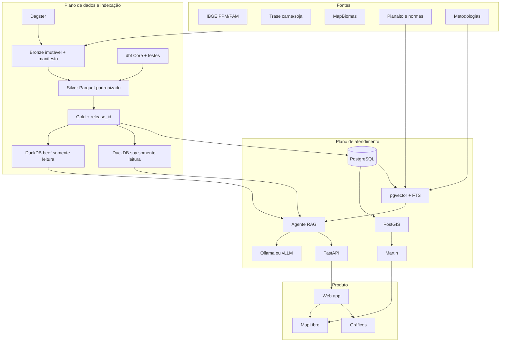

# Plano de implementação da infraestrutura do RAG

**Projeto:** Ambiance  
**Status:** proposta para execução  
**Atualizado em:** 2026-11-11  
**Escopo:** dados tabulares, documentos jurídicos, RAG, mapas, API, observabilidade e deploy com componentes abertos

## 1. Resultado esperado

Construir uma plataforma reproduzível que permita ao agente:

1. consultar números exatos das cadeias de carne bovina e soja por SQL;
2. recuperar legislação e metodologia por busca híbrida;
3. citar a fonte de cada afirmação;
4. retornar instruções estruturadas para mapas e gráficos;
5. operar com dados e modelos versionados;
6. ser implantado e monitorado sem depender de Databricks, Snowflake ou um banco vetorial proprietário.

O plano evolui o repositório atual. Ele não propõe reescrever o RAG que já funciona.

## 2. Decisão arquitetural recomendada

| Responsabilidade | Componente |
|---|---|
| Arquivos originais e Parquet | sistema de arquivos no MVP; armazenamento compatível com S3 em uma evolução |
| Ingestão | Python + DuckDB/Polars |
| Transformações SQL | dbt Core + dbt-duckdb, introduzido depois dos contratos |
| Orquestração | Dagster, introduzido depois que cada pipeline tiver CLI idempotente |
| Consultas analíticas do agente | snapshots DuckDB somente leitura |
| Dados online e geoespaciais | PostgreSQL + PostGIS |
| Documentos e vetores | PostgreSQL + pgvector + full-text search |
| API | FastAPI + Pydantic |
| Tiles vetoriais | Martin sobre PostGIS |
| Mapa web | MapLibre GL JS |
| Modelo em desenvolvimento | Ollama local |
| Modelo em produção com GPU | vLLM atrás de proxy; modelo escolhido por avaliação |
| Métricas | Prometheus |
| Dashboards operacionais | Grafana OSS |
| Instrumentação | OpenTelemetry |
| Empacotamento inicial | Docker Compose |

### Por que manter DuckDB e PostgreSQL

- DuckDB é adequado para transformações e consultas analíticas locais sobre Parquet.
- O arquivo DuckDB publicado será um artefato imutável por `release_id`, aberto somente para leitura pelo agente.
- PostgreSQL é o banco de atendimento online, com concorrência, transações e extensões PostGIS/pgvector.
- PostGIS atende geometrias e tiles; pgvector e `tsvector` atendem a busca documental.
- Os dois consumem a mesma publicação Gold, evitando regras de negócio duplicadas.

## 3. Arquitetura-alvo



## 4. Estado atual e lacunas

| Capacidade | Estado atual | Lacuna para produção |
|---|---|---|
| Carne bovina | Parquet, DuckDB, consultas e dicionário | integrar a publicação medalhão e ampliar testes |
| Soja | manifesto, ingestão, DuckDB e consultas | contratos consistentes, tipagem Silver e maior cobertura de testes |
| Leis | parser, chunks, E5, pgvector, FTS e RRF | vigência/versionamento, mais normas, reranking e avaliação |
| Segurança SQL | somente leitura, SELECT, timeout e limite | testes adversariais e auditoria por consulta |
| Avaliação | 30 perguntas e plano de 20 testes | implementar executor, baseline e gates de CI |
| API | servidor HTTP local mínimo | FastAPI, esquema versionado, autenticação e health checks |
| Mapa | ainda não integrado | PostGIS, tiles, MapLibre e contrato de camadas |
| Orquestração | comandos manuais | assets, partições, retries, backfills e agenda |
| Observabilidade | tempos e tokens parciais | traces, métricas, logs e dashboards |
| Deploy | apenas Postgres no Compose | imagens da API, worker, tiles, modelo, proxy e backups |
| Dependências | `requirements.txt` com intervalos abertos | lock reproduzível e verificação de licenças |

## 5. Estratégia de execução

As fases abaixo são gates: uma fase só publica artefatos se seus critérios de aceite forem atendidos. Os intervalos são estimativas para planejamento, não compromissos de calendário. Com uma equipe de 2 a 4 pessoas, o MVP de infraestrutura tende a ocupar de 10 a 16 semanas; uma pessoa trabalhando parcialmente precisará de mais tempo.

### Fase 0 — Fundação reproduzível

**Esforço indicativo:** 1 sprint.

**Implementar**

- Sincronizar o README do repositório com a explicação atual do RAG.
- Criar `pyproject.toml` e lock de dependências; separar dependências de runtime, desenvolvimento e avaliação.
- Criar comandos únicos para `setup`, `test`, `lint`, `build-data` e `serve`.
- Adicionar `.env.example` sem credenciais.
- Configurar CI para testes unitários, verificação de formatação, schema SQL e links da documentação.
- Registrar ADRs e convenções de branches, commits e releases.

**Critérios de aceite**

- Um clone limpo instala dependências e executa `pytest` com um comando documentado.
- Nenhum segredo ou dado grande aparece no Git.
- Dependências resolvidas são reproduzíveis.

### Fase 1 — Inventário e contratos dos dados

**Esforço indicativo:** 1 sprint.

**Implementar**

- Inventariar automaticamente os arquivos existentes em `/Users/aluno1/Agro`.
- Criar um catálogo YAML/JSON por dataset contendo:
  - identificador estável;
  - fonte e URL;
  - licença e data de obtenção;
  - versão, SHA-256 e tamanho;
  - período, grão, território e unidade;
  - schema esperado e colunas obrigatórias;
  - destino Bronze, Silver e Gold;
  - observações metodológicas.
- Criar contratos para IBGE, Trase, MapBiomas, leis e metodologias.
- Criar uma matriz de cobertura temporal e territorial.

**Critérios de aceite**

- 100% dos arquivos usados por pipelines possuem entrada no catálogo.
- Arquivos duplicados e versões conflitantes são sinalizados.
- Um arquivo desconhecido não entra silenciosamente na publicação.

### Fase 2 — Bronze imutável e ingestão idempotente

**Esforço indicativo:** 1 a 2 sprints.

**Implementar**

- Manter os arquivos atuais fora do Git e referenciá-los por configuração.
- Criar um comando de ingestão por fonte.
- Registrar cada execução em manifesto: entrada, hash, linhas, schema, horário, resultado e erro.
- Nunca modificar o arquivo original; correções geram novo artefato.
- Aplicar escrita atômica e reprocessamento apenas quando hash ou versão mudarem.

**Critérios de aceite**

- Executar duas vezes a mesma carga produz o mesmo resultado sem duplicar dados.
- Contagem de linhas e hash são verificáveis.
- Falha parcial não publica um dataset incompleto.

### Fase 3 — Silver canônica e qualidade

**Esforço indicativo:** 2 sprints.

**Implementar**

- Padronizar nomes, tipos, datas, unidades e valores nulos.
- Criar dimensões compartilhadas de território, tempo, produto, fonte, métrica, empresa e país.
- Usar código IBGE como chave territorial sempre que existir.
- Preservar a granularidade e a metodologia de cada fonte.
- Separar explicitamente:
  - desmatamento observado pelo MapBiomas;
  - exposição ao desmatamento do Trase;
  - emissões territoriais e emissões atribuídas à cadeia.
- Introduzir dbt para modelos SQL, documentação e testes de chaves, domínios, relacionamentos e regras de negócio.
- Manter testes Python para parsing, arquivos e lógica que não pertence ao SQL.

**Testes obrigatórios**

- unicidade e não nulidade das chaves;
- integridade referencial territorial;
- anos dentro da cobertura declarada;
- unidades aceitas;
- percentuais entre 0 e 100 quando aplicável;
- ausência de conversão silenciosa de `NULL` para zero;
- reconciliação de totais antes/depois da limpeza;
- detecção de mudança de schema.

**Critérios de aceite**

- Todos os modelos Silver possuem descrição, grão, chave e testes.
- Nenhuma fonte perde rastreabilidade.
- Testes falhos impedem publicação Gold.

### Fase 4 — Gold, releases e artefatos para o RAG

**Esforço indicativo:** 1 a 2 sprints.

**Implementar**

- Criar marts de município/ano, estado/ano, bioma/ano, fluxos, instalações e indicadores de mapa.
- Definir um `release_id` para cada publicação.
- Gerar `trase.duckdb` e `soy.duckdb` exclusivamente a partir da Silver/Gold aprovada.
- Carregar tabelas online no PostgreSQL/PostGIS a partir da mesma release.
- Gravar catálogo de métricas e caveats em formato legível por máquina.
- Criar relatório de publicação com hashes, linhas, cobertura e resultado dos testes.

**Critérios de aceite**

- RAG e mapa informam o mesmo `release_id`.
- Totais de controle batem entre Gold, DuckDB e PostgreSQL.
- O agente abre os DuckDBs em modo somente leitura.
- Uma release anterior pode ser restaurada.

### Fase 5 — RAG documental e avaliação contínua

**Esforço indicativo:** 1 a 2 sprints para o primeiro gate; trabalho contínuo depois.

**Implementar**

- Preservar originais e versões consolidadas das leis.
- Modelar vigência, jurisdição, abrangência e situação do dispositivo.
- Indexar metodologia oficial do Trase separadamente das leis.
- Manter chunk por artigo e cabeçalho contextual.
- Manter E5 com prefixos `query:`/`passage:` enquanto for o baseline.
- Medir busca semântica, busca textual e RRF separadamente.
- Avaliar um cross-encoder como reranker, mas promovê-lo apenas se melhorar o conjunto de avaliação dentro do orçamento de latência.
- Implementar `eval/run_eval.py` conforme `eval/PLANO_AVALIACAO.md`.

**Métricas**

- Leis: Hit Rate@k, Recall@k e MRR por artigo.
- SQL: consulta/ferramenta correta, filtros corretos, valor e unidade corretos.
- Resposta: validade das citações, faithfulness, cobertura e recusa adequada.
- Operação: latência por etapa, tokens, erros e tentativas de ferramenta.

**Critérios de aceite**

- Existe um baseline versionado com as 20 perguntas previstas.
- Mudanças de embedding, chunking, prompt, modelo ou busca geram comparação contra o baseline.
- Nenhuma release regride silenciosamente métricas críticas.
- Notas automáticas são auditadas por amostra humana.

### Fase 6 — API de produção e contrato do agente

**Esforço indicativo:** 1 a 2 sprints.

**Implementar**

- Substituir o servidor HTTP mínimo por FastAPI.
- Versionar endpoints em `/api/v1`.
- Endpoints iniciais:
  - `POST /api/v1/ask`;
  - `GET /api/v1/sources/{id}`;
  - `GET /api/v1/catalog/metrics`;
  - `GET /health/live`;
  - `GET /health/ready`.
- Validar entrada e saída com Pydantic.
- Implementar o contrato estruturado:
  - resposta;
  - domínio;
  - citações de dados e leis;
  - chamadas de ferramentas;
  - especificação do mapa;
  - especificação de gráficos;
  - cobertura e avisos;
  - `release_id`, modelos e versões.
- Adicionar IDs de correlação, timeout global, cancelamento e limites de requisição.

**Critérios de aceite**

- OpenAPI descreve todos os contratos.
- Respostas inválidas do LLM não chegam ao cliente sem validação determinística.
- Cada número citado pode ser ligado a uma chamada SQL e release.

### Fase 7 — Plano geoespacial e mapa

**Esforço indicativo:** 1 a 2 sprints.

**Implementar**

- Habilitar PostGIS no mesmo cluster PostgreSQL que usa pgvector, em schemas separados.
- Criar uma imagem PostgreSQL própria e versionada com PostGIS + pgvector; não depender de uma imagem que contenha apenas uma das extensões.
- Carregar limites territoriais com código IBGE, fonte, data e simplificações por zoom.
- Criar views/funções de tiles com somente os campos necessários.
- Servir tiles pelo Martin.
- Integrar MapLibre e o contrato de mapa retornado pela IA.
- Usar OpenStreetMap como mapa-base com atribuição e política de tiles compatível; não usar o servidor público padrão como infraestrutura de produção.

**Critérios de aceite**

- O mapa exibe UF e município sem enviar geometrias completas pela API JSON.
- Tiles respeitam filtros de métrica, ano e release.
- A camada solicitada pela IA passa por uma allowlist; o LLM não injeta SQL ou nomes arbitrários de tabela.

### Fase 8 — Modelo aberto e portabilidade do provedor

**Esforço indicativo:** 1 sprint para adaptação; benchmark separado.

**Implementar**

- Criar uma interface de provedor compatível com ferramentas e resposta estruturada.
- Usar Ollama para desenvolvimento local.
- Usar vLLM no ambiente Linux com GPU quando houver hardware apropriado.
- Manter o modelo fora da imagem da API e fixar nome, revisão, quantização e licença no manifesto de release.
- Avaliar modelos candidatos com o mesmo conjunto de perguntas, temperatura e limites.
- Remover a dependência obrigatória do OpenRouter no alvo final.

**Critérios de aceite**

- Trocar o provedor exige configuração, não alteração nas ferramentas de dados.
- O modelo escolhido sustenta tool calling, português, citações e JSON dentro do gate definido.
- A licença do modelo foi revisada; `open weights` não é tratado automaticamente como `open source`.

### Fase 9 — Orquestração, observabilidade e segurança

**Esforço indicativo:** 1 a 2 sprints.

**Implementar**

- Transformar comandos idempotentes em assets do Dagster.
- Particionar cargas anuais quando a fonte permitir.
- Criar schedules, sensors, retries e backfills.
- Instrumentar API, agente, ferramentas SQL, retrieval e LLM com OpenTelemetry.
- Expor métricas ao Prometheus e dashboards no Grafana:
  - volume de perguntas;
  - latência p50/p95/p99;
  - latência por ferramenta;
  - taxa de erro;
  - timeout SQL;
  - documentos e chunks indexados;
  - falhas de citação;
  - tokens e custo computacional;
  - release em atendimento.
- Usar logs JSON com `request_id`, sem registrar credenciais ou contexto sensível integral.
- Aplicar rate limiting, autenticação, CORS restrito e limites de payload.
- Manter privilégio mínimo: conexões separadas para migração, ingestão, consulta e tiles.
- Testar prompt injection direta e indireta; tratar documentos recuperados como dados, não instruções.

**Critérios de aceite**

- Uma pergunta pode ser rastreada de ponta a ponta por `request_id`.
- Alertas existem para indisponibilidade, aumento de erro e latência.
- O agente não possui credenciais de escrita nos bancos consultados.
- Backups e restauração do PostgreSQL foram testados.

### Fase 10 — Deploy e gate de produção

**Esforço indicativo:** 1 a 2 sprints.

**Implementar**

- Expandir o Compose com perfis de desenvolvimento e produção.
- Serviços iniciais:
  - `postgres` com PostGIS + pgvector;
  - `api`;
  - `dagster-webserver` e `dagster-daemon`;
  - `martin`;
  - `ollama` no desenvolvimento ou `vllm` em host GPU;
  - `prometheus`;
  - `grafana`;
  - proxy reverso TLS.
- Fixar imagens por versão/digest e executar containers sem root quando suportado.
- Usar secrets montados como arquivo, não gravados em imagens ou Git.
- Criar migrações SQL e procedimento de rollback.
- Criar staging com dados reduzidos ou anonimizados e a mesma topologia lógica.
- Executar teste de carga, restauração e rollback antes de produção.

**Critérios de aceite**

- `docker compose up` sobe um ambiente verificável por health checks.
- CI constrói imagens e executa testes sem acessar dados secretos.
- Deploy promove uma release já avaliada, sem reconstruir dados em produção.
- Rollback restaura aplicação, bancos e `release_id` compatíveis.

## 6. Ordem de implementação resumida

| Ordem | Marco | Dependência | Saída principal |
|---:|---|---|---|
| 1 | Fundação | repositório atual | ambiente reproduzível |
| 2 | Catálogo e contratos | inventário local | datasets governados |
| 3 | Bronze | contratos | cargas idempotentes |
| 4 | Silver | Bronze | Parquet canônico e testes |
| 5 | Gold e releases | Silver aprovada | DuckDB + PostgreSQL coerentes |
| 6 | Avaliação RAG | Gold e documentos | baseline e gates |
| 7 | API | contratos do RAG | interface estável |
| 8 | Geoespacial | Gold + API | tiles e mapa controlado pela IA |
| 9 | Modelo local | baseline | provedor aberto validado |
| 10 | Orquestração e observação | CLIs estáveis | operação automatizada |
| 11 | Produção | todos os gates | deploy e rollback testados |

## 7. Backlog inicial recomendado

As primeiras tarefas devem ser pequenas e revisáveis:

1. Atualizar o README principal com carne, soja, leis e arquitetura atual.
2. Criar o schema do catálogo de datasets.
3. Gerar automaticamente o inventário dos arquivos locais, sem movê-los.
4. Criar testes do catálogo e dos hashes.
5. Definir `release_id` e manifesto de publicação.
6. Definir dimensão territorial e regras de código IBGE.
7. Migrar um fluxo vertical pequeno: IBGE soja → Bronze → Silver → Gold.
8. Publicar esse fluxo em DuckDB e PostgreSQL e reconciliar totais.
9. Implementar `eval/run_eval.py` e registrar o baseline existente.
10. Só depois generalizar para Trase, MapBiomas e carne bovina.

O fluxo vertical da soja reduz risco: valida contratos, testes, releases e dupla publicação antes de processar os datasets maiores.

## 8. Estrutura de diretórios proposta

```text
Ambiance/
├── data/
│   ├── catalog/              # manifestos versionados
│   ├── contracts/            # schemas e regras
│   ├── raw/                  # ignorado pelo Git
│   └── processed/            # ignorado pelo Git
├── dbt/
│   ├── models/staging/
│   ├── models/silver/
│   ├── models/gold/
│   └── tests/
├── orchestration/               # Dagster
├── migrations/                  # PostgreSQL/PostGIS/pgvector
├── src/
│   ├── ingestion/
│   ├── domain/
│   ├── retrieval/
│   ├── agent/
│   └── api/
├── eval/
├── observability/
├── deploy/
├── docs/
└── knowledge/
```

A reorganização deve ser incremental. Não mover todo o código antes do primeiro fluxo vertical funcionar.

## 9. Ambientes

### Desenvolvimento

- Dados locais configurados por caminho.
- DuckDB e PostgreSQL em containers/volumes locais.
- Ollama local.
- Amostra de dados para testes rápidos.

### CI

- Dados sintéticos e fixtures pequenas.
- Sem chaves externas.
- Testes unitários, contratos, SQL, migrações e documentação.

### Staging

- Mesma topologia lógica de produção.
- Release completa ou subconjunto controlado.
- Avaliação RAG, testes de carga e rollback.

### Produção

- Artefatos imutáveis promovidos de staging.
- Bancos com usuários e privilégios separados.
- Backups, monitoramento e TLS.
- vLLM em GPU separada quando necessário; a API não depende do ciclo de vida do modelo.

## 10. Gates de qualidade

Uma release só pode ser promovida se:

- todos os contratos e testes de dados passarem;
- hashes e contagens estiverem registrados;
- DuckDB e PostgreSQL tiverem o mesmo `release_id`;
- migrações forem aplicadas com sucesso;
- o conjunto RAG não apresentar regressão bloqueante;
- citações forem válidas;
- health checks e smoke tests passarem;
- vulnerabilidades críticas conhecidas nas imagens forem tratadas;
- backup e rollback forem compatíveis com a release.

## 11. Decisões ainda pendentes

Estas escolhas devem ser feitas com protótipo e medição, não por preferência:

1. Qual modelo aberto atende melhor português, tool calling e citações no hardware disponível?
2. Qual reranker melhora definições jurídicas sem ultrapassar a meta de latência?
3. Qual volume de tráfego e SLO o MVP precisa suportar?
4. O ambiente de produção terá GPU própria?
5. Qual armazenamento S3 compatível aberto será adotado quando o sistema de arquivos deixar de bastar?
6. Quais normas estaduais entram primeiro e quem valida a vigência jurídica?

## 12. Definição de concluído do MVP de infraestrutura

O MVP está concluído quando uma pessoa consegue:

1. obter um clone limpo;
2. configurar caminhos e secrets documentados;
3. executar uma carga idempotente;
4. produzir uma release Bronze/Silver/Gold validada;
5. indexar leis e metodologias;
6. subir o ambiente com Docker Compose;
7. perguntar algo misto sobre cadeia e legislação;
8. receber texto, citações, mapa e gráfico estruturados;
9. rastrear a resposta até SQL, chunks e versões;
10. observar latência e erros;
11. restaurar backup ou voltar para a release anterior.

## 13. Documentos relacionados

- `README.md`
- `docs/dicionario_dados.md`
- `eval/PLANO_AVALIACAO.md`
- `docs/HISTORICO_IMPLEMENTACAO.md`
- `knowledge/04-RAG/Arquitetura do RAG.md`
- `knowledge/08-Estudos/Trilha de estudos - Infraestrutura RAG.md`
