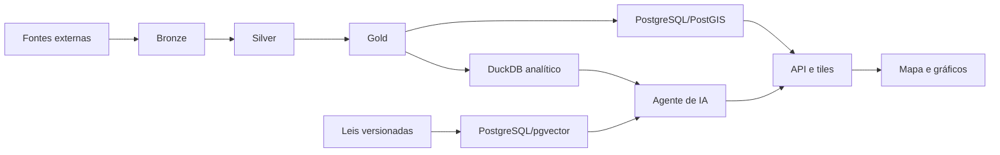

# Arquitetura geral

A arquitetura combina [[Arquitetura de dados]], [[Arquitetura do RAG]] e uma camada geoespacial para o produto descrito em [[Visão do produto]].

## Componentes propostos

- Python, Polars e DuckDB para ingestão e transformação.
- Parquet para armazenamento analítico.
- PostgreSQL, PostGIS e pgvector para atendimento online.
- FastAPI para a API do produto.
- MapLibre para o mapa interativo.
- Ollama ou vLLM para servir o modelo local.
- Docker Compose no MVP.

As escolhas devem ser formalizadas em [[Decisões arquiteturais]].
